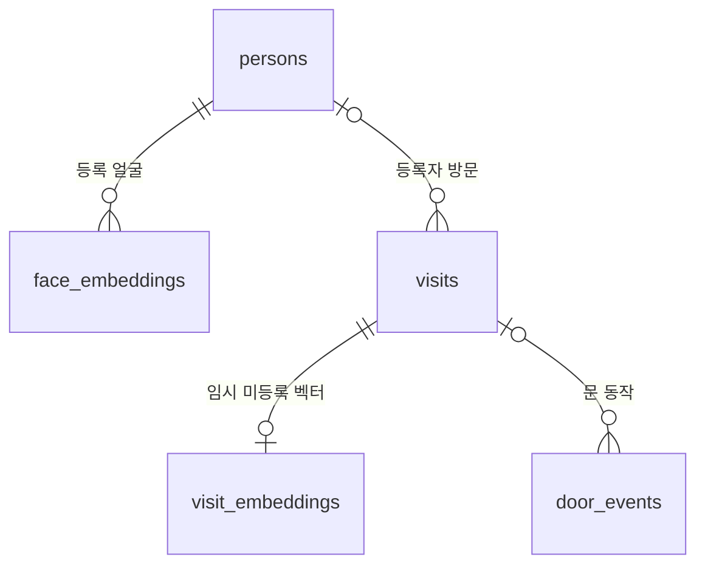

# 방문자 확인 시스템 DB 설계 · 버전 1

## 1. 시작하기

Python 3.10 이상, 기본 모듈 `sqlite3`만 사용합니다. 별도 서버나 pip 설치는 필요 없습니다.
VS Code에서 VisitorVerification 폴더를 열고 터미널에서 실행합니다.

```powershell
py -X utf8 database.py
py -X utf8 db_example.py
py -X utf8 -m unittest discover -s tests -v
```

- `database.py`: 실제 `data/visitor.db`를 초기화합니다. 등록자나 가짜 방문 기록은 넣지 않습니다.
- `db_example.py`: 임시 DB에서 등록 → 방문 → 문 열림 → 통과 → 닫힘 → 조회를 시연합니다.
  실행 후 임시 DB는 삭제되며 실제 DB는 변경하지 않습니다.
- `tests/test_database.py`: 각 테스트마다 별도 임시 DB를 사용합니다.
- 기존 `sqlite_demo.py`, `data/demo.db`는 첫 학습용으로 유지합니다.
- 경로는 Python 파일의 위치를 기준으로 하므로 터미널 위치가 바뀌어도 같습니다.
- 다른 DB를 초기화하려면 `py -X utf8 database.py --db data/other.db`를 사용합니다.

## 2. 구조



테이블은 엑셀의 표에 해당하고, 행 한 개는 등록자/방문/문 동작 한 건입니다.
`id`는 행의 고유 번호(PK), `person_id`와 `visit_id`는 다른 표의 행을 가리키는 번호(FK)입니다.
`NULL`은 아직 값이 없거나 해당되지 않음을 뜻합니다.

계획서의 네 테이블을 기본으로, 미등록자 중복 확인 벡터를 보관할 `visit_embeddings`를 추가했습니다.
사람 추적 ID와 쿨다운 상태는 B의 메인 루프에서 관리하며 DB가 방문 중복을 자동 판정하지 않습니다.

## 3. 테이블 상세

### persons — 등록자

| 컬럼 | 형식 | 의미 |
|---|---|---|
| id | INTEGER PK | 등록자 번호 |
| name | TEXT NOT NULL | 공백만 있는 이름은 금지. 동명이인은 허용 |
| photo_path | TEXT, NULL 허용 | 대표 등록 사진의 경로 |
| created_at | TEXT NOT NULL | 등록 시각 |

### face_embeddings — 등록 얼굴 벡터

| 컬럼 | 형식 | 의미 |
|---|---|---|
| id | INTEGER PK | 벡터 번호 |
| person_id | INTEGER FK NOT NULL | persons.id |
| model_key | TEXT NOT NULL | 얼굴 모델·전처리 버전 식별자 |
| dimension | INTEGER NOT NULL | 벡터 길이. 0보다 커야 함 |
| embedding | BLOB NOT NULL | little-endian float32, 길이 = dimension × 4바이트 |
| created_at | TEXT NOT NULL | 벡터 저장 시각 |

- 1명당 3~5개 등록이 목표지만 개수는 강제하지 않습니다. 시험용 1개도 허용합니다.
- 얼굴 추출 라이브러리의 벡터를 1차원 숫자 목록으로 전달하면 DB 함수가 BLOB으로 변환합니다.
- 불러올 때는 다시 Python float 목록으로 반환합니다. NumPy 배열이 필요하면 A가 변환합니다.
- 예시 모델 키: `sface-model1-preprocess-none-v1`. 모델 파일/전처리 변경 시 새 키를 사용합니다.
- 같은 키의 벡터 길이가 다르면 저장을 거부합니다. 모델 키와 전처리의 실제 일치는 호출자가 보장합니다.
- 서로 다른 모델의 벡터는 비교하지 않습니다. `load_embeddings()`는 모델 키를 반드시 받습니다.

### visits — 확정된 방문 판정

| 컬럼 | 형식 | 의미 |
|---|---|---|
| id | INTEGER PK | 방문 번호. save_visit() 반환값 |
| visited_at | TEXT NOT NULL | 판정 기록 시각 |
| category | TEXT NOT NULL | registered / unregistered / unknown |
| person_id | INTEGER FK, NULL 허용 | 등록자는 persons.id, 그 외는 NULL |
| person_name | TEXT, NULL 허용 | 방문 당시 등록자 이름의 복사본 |
| face_distance | REAL, NULL 허용 | 얼굴 비교 거리. 유한한 0 이상 숫자 |
| message | TEXT NOT NULL | 방문자에게 출력한 안내 문구 |
| image_path | TEXT, NULL 허용 | 방문 사진 경로 |
| approval_status | TEXT NOT NULL | 아래 승인 상태 참고 |
| decided_at | TEXT, NULL 허용 | 선택 기능의 승인·거절·만료 처리 시각 |
| door_opened | INTEGER NOT NULL | 이 방문에 열림 이벤트가 기록된 적이 있으면 1, 기본 0 |
| passed_at | TEXT, NULL 허용 | 최초 통과 시각 |

`unknown`은 얼굴 추출 불가이며 `unregistered`(얼굴은 있으나 등록자와 불일치)와 다릅니다.
인식 불가 5초 후 어떤 category를 확정할지는 A/B의 판정 로직에서 결정합니다.
판정 중간 결과를 매 프레임 저장하지 않고 확정된 방문을 한 번 저장합니다.
face_distance의 계산과 기준값은 A가 담당합니다. 유사도 점수를 쓴다면 거리로 변환하는 등
계산 의미를 통일해야 하며 DB가 얼굴 일치 여부를 계산하지 않습니다.

| 상황 | 최초 상태 | 후속 상태 |
|---|---|---|
| 등록자 | auto | 변경하지 않음 |
| 미등록자/인식 불가, 기본 기능 | counter | 카운터 안내만 수행 |
| 미등록자/인식 불가, F7 사용 시 명시 지정 | pending | approved / rejected / expired |

승인 API는 pending에만 작동합니다. counter는 승인 대상이 아닙니다.
10분 이상 지난 pending은 승인할 수 없으며, 정확히 10분이 되는 시점부터 만료입니다.
expired의 decided_at은 만료 경계 시각이 아니라 만료를 DB에 처리한 시각입니다.

### visit_embeddings — 최근 미등록자 중복 확인용 임시 벡터

| 컬럼 | 형식 | 의미 |
|---|---|---|
| visit_id | INTEGER PK, FK | visits.id, 방문당 최대 1개 |
| model_key | TEXT NOT NULL | 등록 벡터와 같은 모델 식별 규칙 |
| dimension | INTEGER NOT NULL | 벡터 길이 |
| embedding | BLOB NOT NULL | little-endian float32 벡터 |
| expires_at | TEXT NOT NULL | 방문 시각 + 10분 |

얼굴을 추출한 unregistered 방문에만 선택적으로 저장합니다. unknown에는 벡터를 저장하지 않습니다.
만료된 벡터는 조회에서 즉시 제외됩니다. 실제 삭제는 `cleanup_expired_embeddings()`를 호출해야 합니다.
B의 메인 루프에서 예를 들어 1분마다 정리 함수를 호출하면 됩니다. 자동 스케줄러는 구현하지 않았습니다.
이 삭제는 임시 벡터만 대상으로 하며 방문 기록과 사진은 남습니다.

### door_events — 문 동작 이력

| 컬럼 | 형식 | 의미 |
|---|---|---|
| id | INTEGER PK | 이벤트 번호 |
| event_at | TEXT NOT NULL | 이벤트 시각 |
| event | TEXT NOT NULL | open / close / pass |
| visit_id | INTEGER FK, NULL 허용 | 관련 방문. open/pass에는 필수 |
| event_key | TEXT UNIQUE, NULL 허용 | 같은 이벤트의 수신 재시도를 중복 저장하지 않기 위한 키 |

- open: auto 또는 approved 방문만 저장 가능하며 door_opened를 1로 변경합니다.
- pass: 먼저 open이 기록되어야 합니다. 최초 passed_at을 저장하며 후속 pass가 덮어쓰지 않습니다.
- close: 종료 이력을 남깁니다. door_opened는 과거에 열렸는지이므로 다시 0으로 바꾸지 않습니다.
- 시작 시 CLOSED처럼 관련 방문이 없는 close는 visit_id 없이 저장할 수 있습니다.
- 이벤트와 방문 요약은 한 트랜잭션으로 갱신하므로 한쪽만 저장되지 않습니다.
- event_key가 같고 event/visit_id도 같으면 기존 이벤트 번호를 반환합니다. 다른 내용이면 거부합니다.
  서로 다른 실제 동작에는 다른 키를 사용하세요. 영구 UUID 등을 메인 루프에서 만들 수 있습니다.
- 이 테이블이 문을 움직이지는 않습니다. 명령 전송/아두이노 응답 처리 후 메인 루프가 기록합니다.
  현재 프로토콜에는 OPENED 응답이나 문 위치 센서가 없으므로 open은 소프트웨어가 기록한 동작이며,
  실제 물리적 열림 완료가 보장되는 값은 아닙니다. 실제 문 상태의 확정은 후속 하드웨어 통합 범위입니다.
- 동시에 여러 사람이 감지될 때 어느 방문이 현재 문 동작의 대상인지 B가 관리해야 합니다.
  DB는 visit_id를 검증하지만 적외선 PASS가 실제 누구의 통과인지는 판별할 수 없습니다.

## 4. 공용 함수

모든 함수의 `db_path`는 생략하면 data/visitor.db입니다. 연결 객체는 전달하지 않습니다.
각 함수는 짧은 연결을 열고 성공 시 commit, 실패 시 rollback한 뒤 연결을 닫습니다.
조회 결과는 dict 목록이며 벡터 조회의 embedding만 float 목록입니다.

| 함수 | 주요 입력 | 반환 |
|---|---|---|
| init_db() | db_path 선택 | 실제 DB의 Path |
| register_person() | name, embeddings, model_key=, photo_path= 선택 | person_id |
| add_embeddings() | person_id, embeddings, model_key= | 추가한 벡터 수 |
| list_persons() | 없음 | 등록자 목록, embedding_count 포함 |
| load_embeddings() | model_key=, dimension= 선택 | id/person_id/person_name/embedding 등 |
| delete_person() | person_id | 삭제했으면 True, 없으면 False |
| save_visit() | category, person_id= 등 | visit_id |
| get_visit() | visit_id | 방문 dict 또는 None |
| get_records() | category=, day=, name=, limit=, offset= | 방문 목록 |
| get_today_stats() | day= 선택 | registered/unregistered/unknown/total 건수 |
| recent_unknown_embeddings() | model_key=, dimension=, now= 선택 | 미등록 벡터 목록, visit_id 포함 |
| cleanup_expired_embeddings() | now= 선택 | 삭제한 임시 벡터 수 |
| save_door_event() | event, visit_id 선택, event_at=, event_key= 선택 | event_id |
| update_passed() | visit_id, event_at=, event_key= 선택 | pass event_id |
| get_door_events() | visit_id | 해당 방문의 문 동작 목록 |
| expire_pending() | now= 선택 | 만료 처리한 방문 수 |
| decide_approval() | visit_id, approved(bool), now= 선택 | 이번 호출이 결정했으면 True |

`save_visit()` 선택 인수:
person_id, face_distance, message, image_path, approval_status, visited_at, embedding, model_key.
등록자 이름과 기본 안내 문구는 DB 함수가 채웁니다. 실제 표시 문구가 다르면 message로 전달합니다.
미등록 벡터를 저장하려면 embedding과 model_key를 함께 전달합니다.

`update_passed()`가 pass 이벤트 저장도 수행하므로 동일 신호에 save_door_event('pass')와
update_passed()를 모두 호출할 필요가 없습니다.

## 5. A/B에서 호출하는 예

```python
import database as db

# 프로그램 시작 시 한 번. 기존 데이터는 보존됩니다.
db.init_db()

# A: 이미 등록한 얼굴을 인식할 때
vectors = db.load_embeddings(model_key="실제로-사용하는-모델-전처리-버전")

# B: A가 판정을 확정한 후, 실제 존재하는 등록자 번호를 전달
# visit_id = db.save_visit("registered", person_id=person_id,
#                          face_distance=distance, image_path="captures/2026-11-07/unique.jpg")
# db.save_door_event("open", visit_id)  # 실제 명령/응답 처리에 맞춰 호출
# db.update_passed(visit_id)            # PASS 수신 시 한 번
# db.save_door_event("close", visit_id) # CLOSED 수신 시

# B: 미등록자 기본 동작은 문을 열지 않고 카운터 안내
visit_id = db.save_visit("unregistered")

# B: 대시보드
records = db.get_records(day="2026-11-07", category="unregistered", limit=50, offset=0)
stats = db.get_today_stats()
```

이 예는 호출 방법 설명입니다. 실제 등록 없이 등록자 번호를 임의로 지정하면 저장이 거부됩니다.
Flask 화면과 시리얼 모듈은 별도 구현 대상입니다. F7 함수도 DB 상태만 변경하며
인증·승인 화면·실제 문 열기·승인 소비 처리는 포함하지 않습니다.

## 6. 날짜와 조회 규칙

- DB 시간은 모두 UTC `2026-11-07T03:00:00.000000Z` 형태로 통일합니다.
- 저장 시 시간이 생략되면 현재 시각을 사용합니다. 직접 지정하면 시간대가 있는 datetime을 전달합니다.
- day 필터와 오늘 통계는 한국 시간(UTC+9) 기준 자정 이상~다음 자정 미만입니다.
- 화면에 표시할 때는 UTC 값을 한국 시간으로 변환하세요.
- 방문은 visited_at DESC, id DESC 순서입니다. 기본 100건, 최대 1000건, offset으로 페이지 이동합니다.
- name은 이름 부분 검색이며 `%`, `_`도 일반 문자로 취급합니다. SQL 문자열로 직접 합치지 않습니다.
- 통계는 고유 인원 수가 아니라 저장된 방문 건수입니다. 중복 안내·기록 억제는 B가 담당합니다.

## 7. 동시 사용·데이터 관리

- WAL 모드로 영상 프로그램과 대시보드가 같은 노트북의 DB 파일을 함께 사용합니다.
- 모든 공용 연결에 foreign_keys=ON, busy_timeout=5000을 적용합니다. 쓰기는 한 번에 하나이며,
  WAL도 잠금을 완전히 없애지는 않습니다. 5초 이상 잠기면 호출자에 OperationalError가 전달됩니다.
- 등록자+벡터, 방문+임시 벡터, 문 이벤트+방문 요약은 각각 하나의 트랜잭션입니다.
- 승인 결정은 조건부 갱신하므로 동시에 두 요청이 와도 첫 결정만 성공합니다.
- SQLite 연결 객체를 스레드 간 공유하지 않습니다. 각 함수가 자체 연결을 사용합니다.
- DB는 로컬 디스크에 두고 휴대폰은 Flask로 조회합니다. 네트워크 공유 폴더에 DB를 두지 않습니다.
- 인덱스는 날짜/구분/승인 상태/등록자/모델/벡터 만료/방문별 문 동작 조회를 지원합니다.
- schema.sql은 빈 DB 초기화용입니다. 버전은 PRAGMA user_version=1로 관리합니다.
  이후 구조 변경에는 별도 마이그레이션이 필요합니다. 다른 버전이나 학습용 DB를 덮어쓰지 않습니다.

사진은 faces/, captures/에 저장하고 DB에는 프로젝트 기준 상대 경로를 넣습니다.
DB 함수가 사진을 촬영하거나 파일을 생성·삭제하지는 않습니다.
delete_person()은 등록자/등록 벡터를 삭제하고 연결된 방문의 person_id와 person_name을 NULL로,
이름을 포함할 수 있는 message를 일반 문구로 바꿉니다. 방문 이력 자체는 유지합니다.
사진 파일과 image_path에는 개인 정보가 남을 수 있으므로 이것만으로 완전한 동의 철회 처리는 아닙니다.
사진 삭제·보관 기간·방문 기록 자동 삭제는 후속 구현 범위입니다.
방문 행을 별도 SQL로 삭제할 경우 임시 벡터와 연결된 문 이벤트도 함께 삭제되도록 설계했습니다.

실제 얼굴·사진·DB 파일은 Git에 올리지 않습니다. DB 사용 중 백업은 파일 하나만 복사하지 말고
SQLite backup API를 사용하거나 모든 연결을 종료한 뒤 수행하세요. WAL 파일에 최신 데이터가 남을 수 있습니다.
