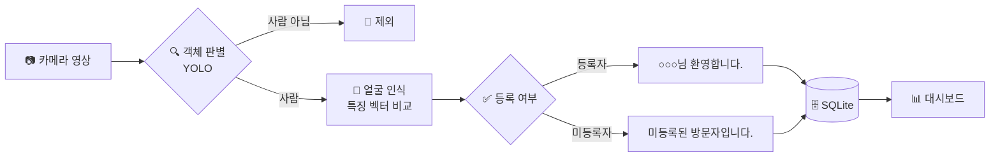

# 🏢 방문자 확인 시스템

> 카메라 영상으로 회사 방문자를 판별하고, **안내 메시지 출력부터 방문 기록 관리까지** 이어지는 영상처리 프로그램

한세대학교 디지털영상처리 팀 프로젝트 · **7조 누구시조**

---

## 📌 프로젝트 소개

회사 출입구에서 방문자를 확인하는 과정을 카메라와 영상처리로 자동화합니다.

- 🙋 **등록자**: 얼굴이 미리 등록된 사람 (임직원, 사전 등록된 방문객 등)
- ❓ **미등록자**: 등록된 얼굴과 일치하지 않아 안내데스크 확인이 필요한 방문자

> 💻 노트북 카메라(내장 또는 USB)로 출입구 상황을 가정해 개발·시연하며, 사전학습 모델을 활용한 **추론 중심**으로 구성합니다.

---

## ✨ 주요 기능

| 순서 | 기능 | 설명 | 상태 |
|:---:|---|---|:---:|
| 1 | 🔍 객체 판별 | YOLO로 사람인지 판별, 사람일 때만 다음 단계 진행 | 🛠️ 개발 예정 |
| 2 | 🙂 얼굴 인식 | 얼굴 특징 벡터를 추출해 등록된 얼굴과 비교 | 🛠️ 개발 예정 |
| 3 | ✅ 등록자/미등록자 구분 | 판정 결과에 따라 안내 메시지 출력 | 🛠️ 개발 예정 |
| 4 | 🗄️ 방문 기록 저장 | 시각·구분·이름·사진을 SQLite에 저장 | 🛠️ 개발 예정 |
| 5 | 📊 대시보드 | 방문 기록을 날짜·구분별로 조회 | 🛠️ 개발 예정 |
| 6 | 📦 택배 감지 | 상자가 일정 시간 놓여 있으면 기록 | ⏸️ 대기 |

### 💬 안내 메시지

| 구분 | 메시지 |
|---|---|
| 등록자 | **"○○○님 환영합니다."** |
| 미등록자 | **"미등록된 방문자입니다."** |

> 출력 방식(화면 오버레이 / 안내 화면 / 음성)은 추후 결정하며, 우선 화면 오버레이로 구현합니다.

---

## 🔄 처리 흐름

- 🗳️ **다수결 판정**: 여러 프레임의 결과를 모아 판정해 오인식과 깜빡임을 줄입니다.
- ⏱️ **쿨다운**: 같은 사람에게는 일정 시간(예: 60초) 동안 안내와 기록을 반복하지 않습니다.

---

## 🛠️ 기술 스택

| 영역 | 기술 |
|---|---|
| 언어 | Python |
| 영상 처리 | OpenCV |
| 객체 판별 | Ultralytics YOLO (COCO 사전학습, yolov8n) |
| 얼굴 인식 | face_recognition 또는 InsightFace *(선정 예정)* |
| 한글 메시지 | Pillow |
| DB | SQLite |
| 대시보드 | Flask 또는 Streamlit *(선정 예정)* |

---

## 🗄️ DB 구조

| 테이블 | 내용 |
|---|---|
| `persons` | 등록자 이름, 대표 사진 경로, 등록 시각 |
| `face_embeddings` | 등록자별 얼굴 특징 벡터 (1인당 3~5장) |
| `visits` | 방문 시각, 구분, 이름, 얼굴 거리, 안내 메시지, 사진 경로 |

> 📁 방문 사진은 `captures/날짜/` 폴더에 파일로 저장하고 DB에는 경로만 기록합니다.

---

## 📅 개발 일정 (6주)

| 주차 | 작업 | 목표 |
|:---:|---|---|
| 1주 | 개발 환경 구축, YOLO 사람 판별 | 🔍 객체 판별 |
| 2주 | 얼굴 등록·특징 벡터 비교 | 🙂 얼굴 인식 |
| 3주 | 등록자/미등록자 판정, 안내 메시지 출력 | ✅ 구분·안내 |
| 4주 | SQLite 방문 기록·사진 저장 | 🗄️ 기록 저장 · 🎯 **최소 완성본** |
| 5주 | 대시보드 구현 | 📊 대시보드 |
| 6주 | 통합 테스트, 시연·발표 준비 | 🚀 최종 시연본 |

> 📦 택배 감지는 5주차까지 핵심 기능이 안정적이고 일정에 여유가 있을 때 착수 여부를 결정합니다.

---

## 🔒 개인정보 보호

- 🧑‍🤝‍🧑 시연에는 **동의한 팀원 얼굴만** 등록합니다.
- 💾 얼굴 사진과 특징 벡터는 외부로 전송하지 않고 **로컬에만** 저장합니다.
- 🚪 출입문 개폐 장치 연동, 위조 방지, 마스크 착용 대응은 이번 범위에서 제외합니다.

---

## 👥 팀 구성

| 이름 | 역할 | 담당 |
|---|---|---|
| 팀원 A | 🔍 인식 | 객체 판별, 얼굴 인식, 임계값 조정 |
| 팀원 B | 🔗 판정·통합 | 등록자/미등록자 판정, 안내 메시지, 전체 통합 |
| 팀원 C | 📊 데이터·대시보드 | SQLite 저장, 대시보드, 일정 관리 |

---

## 📚 문서

- 📝 [프로젝트 계획서](./방문자확인시스템_계획서.md)
- 🎤 [발표 대본](./방문자확인시스템_발표대본.md)
