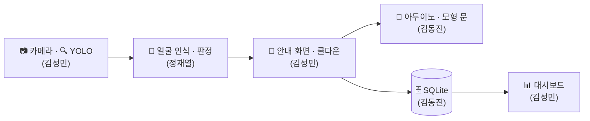

## 🧭 한눈에 보기

| 역할 | 담당 | 한 줄 요약 |
|---|---|---|
| 🙂 **정재열 : 얼굴 인식** | 팀원 A | 얼굴을 인식해서 등록자인지 판정 |
| 🔗 **김성민 : 영상 흐름·화면·연결** | 팀원 B | 카메라·YOLO부터 안내 화면, 아두이노 명령, 대시보드까지 전체 흐름 연결 |
| 🔌 **김동진 : 아두이노·DB** | 팀원 C | 모형 문과 회로, DB와 SQL 함수 |

> 🧪 테스트는 각자 자기 파트를 만들면서 직접 합니다.

---

## 🙂 정재열 : 얼굴 인식

> 카메라에 잡힌 사람의 얼굴을 숫자 벡터로 바꾸고, 등록된 얼굴과 비교해 **등록자 / 미등록자 / 인식 불가**를 판정합니다.

### 📋 담당 업무

| # | 업무 | 주차 |
|:---:|---|:---:|
| ① | 얼굴 특징 추출·비교 (라이브러리 선정·설치 포함) | 1~2주 |
| ② | 얼굴 등록 도구 (팀원 3명 등록) | 2주 |
| ③ | 판정 기준값 실험, CLAHE 밝기 보정 시험 | 3주 |
| ④ | 판정 로직 (다수결, 인식 불가) | 3주 |
| ⑤ | 통합 지원 (B의 메인 루프에 인식 함수 연결) | 4주 |
| ⑥ | 인식 성능 확인·조정 (시연 조명에서 재확인) | 5~6주 |

---

## 🔗 김성민 : 영상 흐름·화면·연결

> 카메라 입력과 YOLO 사람 판별부터 시작해, A의 판정 결과를 받아 **안내 화면, 아두이노 명령, DB 기록**으로 이어지는 메인 루프를 만듭니다. 대시보드도 B가 맡습니다.

### 📋 담당 업무

| # | 업무 | 주차 |
|:---:|---|:---:|
| ① | 개발 환경(`requirements.txt`), 카메라 입력 | 1주 |
| ② | YOLO 사람 판별 (사람별 추적 번호 포함) | 1주 |
| ③ | 한글 안내 화면 (전체 화면, 아래쪽 배너) | 2주 |
| ④ | 노트북 쪽 통신 모듈 (`FakeDoor` → 실제 `Door`) | 1~2주 |
| ⑤ | 메인 루프 (뼈대 → A·C 연결 → 점검) | 2·4·6주 |
| ⑥ | 쿨다운, 미등록자 중복 방지 | 3~4주 |
| ⑦ | 대시보드 기본 틀 | 3주 |
| ⑧ | 기록 조회·통계 화면 | 5주 |
| 🔹 | (선택) 카운터 승인 화면 | 5주 |

---

## 🔌 김동진 : 아두이노·DB

> 모형 출입문과 회로를 만들고 아두이노 프로그램을 작성합니다. 방문 기록을 저장하는 **DB 테이블과 모든 SQL 함수**도 C가 맡습니다.

### 📋 담당 업무

| # | 업무 | 주차 |
|:---:|---|:---:|
| ① | 부품 주문·개별 시험 (LED, 서보, 센서) | 1~2주 |
| ② | DB 테이블, SQL 저장·조회 함수 | 1~2주 |
| ③ | 아두이노 프로그램 (명령 처리, LED, 문 열고 닫기, 통과 감지) | 2~3주 |
| ④ | 폼보드 모형 제작·서보 장착 | 3주 |
| ⑤ | 회로 장착·배선 정리 | 4~5주 |
| ⑥ | 통합 (연동 시험) | 4주 |
| ⑦ | 반복 동작 시험·시연 세팅 | 6주 |
| 🔹 | (선택) 승인용 DB 함수 | 5주 |

---

## 🤝 팀 공통 업무

| 업무 | 방식 | 시점 |
|---|---|:---:|
| 🗓️ 주간 회의 | 매주 30분~1시간, 진행 상황 공유. 진행자는 돌아가며 맡음 | 매주 |
| 📝 함수·명령 약속 | 1주차에 함께 정해 공유 문서에 기록 | 1주 |
| 📄 보고서 | 각자 맡은 부분을 쓰고 함께 취합 | 6주 |
| 🎤 발표 자료·대본 | 발표 담당 페이지별로 작성 | 6주 |
| 🎬 시연 리허설·영상 | 전원이 함께 리허설하고 그때 촬영 | 6주 |
| 📦 (선택) 택배 감지 | 5주차에 여유가 있으면 담당을 정해 진행 | 5주 |

---

## 📅 주차별 작업

| 주차 | 🙂 A: 얼굴 인식 | 🔗 B: 영상 흐름·화면·연결 | 🔌 C: 아두이노·DB |
|:---:|---|---|---|
| 1주 | 라이브러리 선정·설치, 특징 추출 시작 | 개발 환경·카메라, YOLO, `FakeDoor` | 부품 주문, DB 테이블 |
| 2주 | 특징 추출·비교 완성, 얼굴 등록 도구 | 한글 안내 화면, 통신 모듈, 메인 루프 뼈대 | 부품 시험, 아두이노 명령·LED·서보, SQL 함수 |
| 3주 | 기준값 실험·CLAHE, 다수결·인식 불가 | 쿨다운, 대시보드 기본 틀 | 폼보드 모형·서보 장착, 통과 감지 |
| 4주 | 인식 함수 연결 | 메인 루프 연결, 중복 방지 | 회로 장착, 연동 시험 |
| 5주 | 인식률·오인식률 확인, 기준값 조정 | 기록 조회·통계, 🔹 (선택) 카운터 승인 화면 | 배선 정리, 🔹 (선택) 승인용 DB 함수 |
| 6주 | 시연 조명에서 재확인 | 전체 흐름 점검 | 반복 동작 시험, 시연 세팅 |
