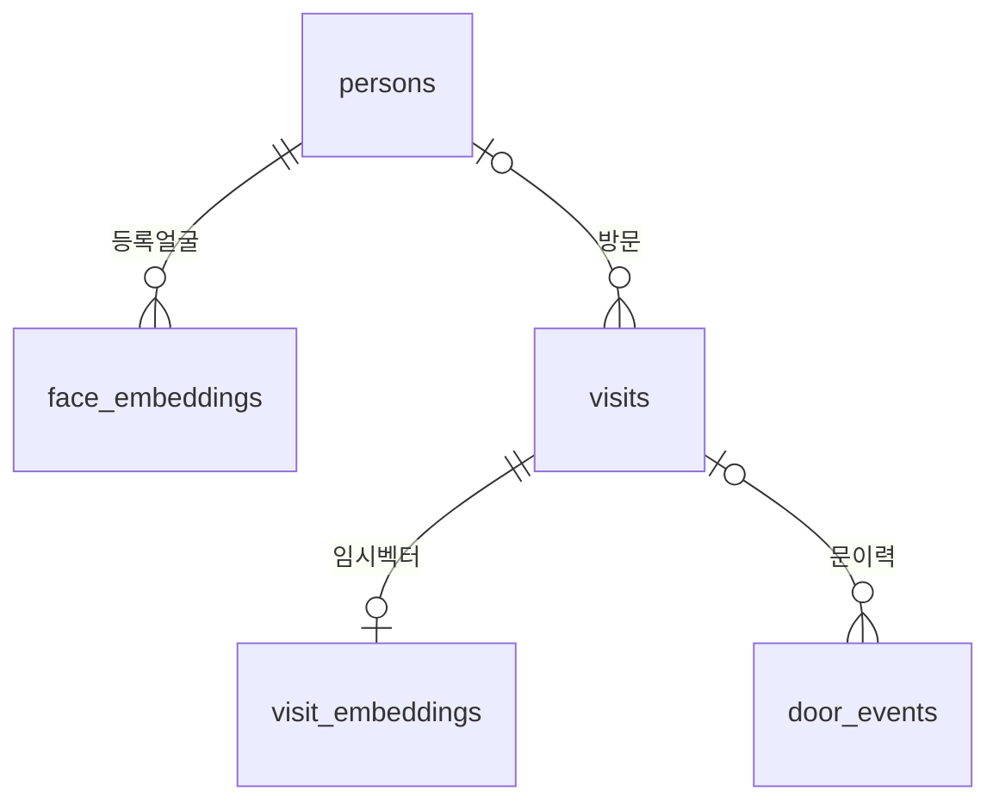

# 방문자 확인 시스템 DB 설계 — 공통 명세 반영 v2

## 1. 실행과 파일 위치

공용 구현은 `db/database.py`입니다. B의 `save_visit(Decision, message, frame)` 호출과 연결됩니다.
루트 `database.py`는 기존 import/초기화 명령을 위한 얇은 호환 진입점이며 별도의 DB 구현은 아닙니다.
테이블 생성 SQL은 루트 `schema.sql`, 실제 DB 기본 위치는 `data/visitor.db`입니다.

Python 3.13 환경에서 프로젝트 루트 터미널을 사용하세요.

```powershell
python -m pip install -r requirements-db.txt
python -m db.database
python -m unittest discover -s tests -v
python db_example.py
```

`python`은 VS Code에서 선택한 프로젝트 가상환경의 실행 파일을 사용하세요.
requirements-db.txt의 NumPy/OpenCV 버전은 확인한 B 브랜치의 requirements.txt와 같습니다.
실제 B 프로젝트 환경에 이미 해당 패키지가 있다면 중복 환경을 만들 필요는 없습니다.
db_example.py와 테스트는 임시 DB와 임시 사진만 사용합니다.

## 2. 공통 파일과 담당 경계

- `common/types.py`: B 브랜치의 실제 Decision, RecognitionResult, PersonBox를 그대로 반영했습니다.
- `common/imageio.py`: B의 한글 경로 대응 imread_unicode()/imwrite_unicode()를 그대로 사용합니다.
- A는 얼굴 특징 추출·비교·판정, B는 안내·중복 판정·시리얼·화면, C는 데이터 저장·조회 담당입니다.
- C의 함수가 B/A의 메인 루프를 자동으로 바꾸지는 않습니다. 연결 코드 교체는 B에서 진행합니다.
- 근거: B 요청 메시지와 GitHub b/develop의 common/types.py, common/imageio.py,
  config.py, main.py, dashboard/app.py 및 ab/develop의 vision/face.py 호출 방식을 확인했습니다.
  작업.md 원문은 확인한 브랜치와 로컬에 없어, 확인하지 못한 3장 세부 규칙까지 검증했다고 보지는 않습니다.

## 3. 데이터 구조



| 테이블 | 주요 컬럼 | 용도 |
|---|---|---|
| persons | id, name, photo_path, created_at | 등록자. 동명이인 허용 |
| face_embeddings | id, person_id, model_key, dimension, embedding, created_at | 등록 얼굴 특징 벡터 |
| visits | id, visited_at, category, person_id, person_name, face_distance, message, image_path, approval_status, decided_at, door_opened, passed_at | 방문과 판정 결과 |
| visit_embeddings | visit_id, model_key, dimension, embedding, expires_at | 미등록자 중복 확인용 임시 벡터 |
| door_events | id, event_at, event, visit_id, event_key | open/close/pass 이벤트 이력 |

벡터는 little-endian float32 BLOB으로 저장하고 모델 키·길이를 함께 검사합니다.
등록 벡터 조회 load_embeddings()는 기존 A 연동과 같이 dict 목록을 반환합니다.
recent_unknown_embeddings()는 B 요청대로 메타데이터 없는 np.float32 1차원 배열 목록을 반환합니다.
서로 다른 모델은 섞지 않습니다. 기본 키는 A의 `sface_2021dec`이며 config.USE_CLAHE가 True면
`_clahe`를 붙입니다. 모델/전처리가 바뀌면 model_key=인수로 A의 실제 키를 명시하세요.
config.FACE_MODEL_KEY가 있으면 이를 기본 모델 이름으로 사용합니다.

## 4. B가 사용하는 함수

```python
from db import database as db

db.init_db()  # 프로그램 시작 시, 조회/저장 전에 한 번

# decision: common.types.Decision, message: 실제 안내 문구, frame: 원본 uint8 BGR 영상
visit_id = db.save_visit(decision, message, frame)
rows = db.get_records(category=None, date="2026-11-21", name=None, limit=200)
vectors = db.recent_unknown_embeddings(minutes=10)
stats = db.get_today_stats()
```

| 함수 | 동작/반환 |
|---|---|
| save_visit(decision, message, frame, approval_status=None) | 방문·사진·미등록 벡터를 저장하고 visit_id 반환 |
| get_records(category=None, date=None, name=None, limit=200) | visits 컬럼 이름을 그대로 쓰는 dict 목록. 최신순 |
| recent_unknown_embeddings(minutes=10) | 해당 시간 범위에 있고 만료되지 않은 np.float32 배열 목록 |
| save_door_event(event, visit_id) | 이벤트 저장과 door_opened/최초 passed_at 갱신. event_id 반환 |
| get_today_stats() | total/registered/unregistered/unknown 건수 dict |

선택적인 db_path=, now=/visited_at=/event_at= 등의 인수는 테스트와 별도 DB에 쓸 수 있습니다.
get_records()는 offset=으로 페이지 이동할 수 있으며 limit은 1~1000입니다.
날짜 입력 이름은 **day가 아니라 date**입니다. get_today_stats()의 선택 인수 day=는 그대로 유지합니다.

## 5. 사진과 방문 저장 규칙

- frame은 비어 있지 않은 높이×너비×3 형태의 np.uint8 BGR 영상이어야 합니다.
- `data/captures/YYYY-MM-DD/HHMMSS_<visit_id>.jpg`에 common.imageio.imwrite_unicode()로 저장합니다.
- DB에는 DATA_DIR 기준 `captures/YYYY-MM-DD/HHMMSS_<visit_id>.jpg`만 저장합니다.
- db_path를 별도 지정하면 기본 사진 저장 기준은 그 DB 파일의 부모 폴더입니다.
  data_dir=를 지정하면 사진 저장 기준 폴더만 바꿀 수 있습니다.
- 같은 시각이어도 visit_id로 파일을 구분합니다. 기존 파일이 있으면 덮어쓰지 않고 저장을 취소합니다.
- 사진 저장이나 후속 DB 갱신에 실패하면 방문/벡터는 rollback하고, 이번에 생성한 사진을 정리합니다.
  프로세스 강제 종료·전원 장애까지 파일과 DB의 원자성을 보장하는 방식은 아닙니다.
- registered는 존재하는 person_id와 auto 상태가 필요합니다. 이름은 Decision.name을 쓰고,
  없으면 persons의 이름을 사용합니다. unregistered/unknown은 person_id가 없어야 합니다.
- 기본 상태는 등록자 auto, 나머지 counter이며 F7 사용 시 pending을 명시할 수 있습니다.
- 미등록자의 Decision.embedding이 있으면 방문과 함께 저장합니다. 없으면 사진/방문만 기록합니다.
- A가 비교 대상 없음으로 반환하는 +inf 거리는 미등록/인식 불가 방문에서 NULL로 저장합니다.
  NaN, 명백한 음수 거리는 거부하고 작은 코사인 반올림 오차만 0으로 보정합니다.
- 임시 벡터 보관 기간은 10분입니다. 조회에서 만료값을 제외하고
  cleanup_expired_embeddings()를 호출하면 실제 삭제합니다. 자동 스케줄러는 포함하지 않습니다.
  minutes를 10보다 크게 지정해도 이미 만료되거나 삭제한 벡터까지 반환하지는 않습니다.

## 6. 시간과 기존 DB 변환

모든 저장 시각은 **한국 시간 `YYYY-MM-DD HH:MM:SS` 문자열**입니다.
visited_at, event_at, created_at, decided_at, passed_at, expires_at에 동일하게 적용합니다.
날짜 필터와 오늘 통계도 한국 시간 자정 기준입니다. 호출자가 시간대 변환을 다시 하면 안 됩니다.
직접 시각을 지정할 때는 시간대 있는 datetime 또는 위 형식의 한국 시간 문자열을 사용합니다.
통계는 고유 인원 수가 아니라 방문 기록 건수입니다.

schema user_version은 2입니다. 기존 v1 DB는 init_db() 호출 시:

1. `data/backups/*.v1-<시각>.backup.db`에 SQLite backup API로 원본을 보관합니다.
2. UTC ISO 문자열을 한국 시간으로 변환합니다. 기존 한국 시간 문자열은 같은 시각으로 유지합니다.
3. 방문 번호·사진 경로·등록 벡터 등 나머지 정보는 유지합니다.
4. 오류가 나면 변경을 rollback하고 v1을 유지합니다. 백업은 남습니다.

v2 DB 재초기화는 데이터를 삭제하거나 중복 변환하지 않습니다.
버전 없는 학습용 demo.db나 지원하지 않는 버전은 덮어쓰지 않습니다.
마이그레이션은 앱들을 시작하기 전 한 번 수행하는 것이 좋습니다.

## 7. 기존 A 함수와 선택 기능

아래 등록자 함수 형식은 기존 A 코드와 동일하게 유지합니다.

- register_person(name, embeddings, model_key=, photo_path=)
- add_embeddings(person_id, embeddings, model_key=)
- load_embeddings(model_key=, dimension=선택) → dict 목록
- list_persons() → embedding_count 포함 dict 목록
- delete_person(person_id) → 삭제 여부

등록자 삭제 시 등록 벡터를 함께 지우고 과거 방문의 이름/안내 문구를 정리합니다.
사진 파일 삭제까지 처리하지는 않습니다.
승인용 decide_approval()/expire_pending(), 단건 get_visit(), 방문별 get_door_events()도 유지합니다.
동시 승인 요청은 처음 결정만 성공하고 만료된 요청은 다시 승인하지 못합니다.

## 8. 통신·동시 접근

- WAL, 각 연결 foreign_keys=ON, 5초 busy_timeout, 짧은 트랜잭션을 사용합니다.
- SQL 인수 바인딩을 사용하며 이름 검색의 %/_도 일반 문자로 처리합니다.
- 각 함수가 연결을 열고 닫으므로 Flask/수신 스레드가 연결 객체를 공유하지 않습니다.
- 문 이벤트와 방문 요약은 함께 저장합니다. event_key=가 같은 재요청은 중복 저장하지 않습니다.
- 현재 센서는 없으므로 보드에서 PASS가 오지 않습니다. update_passed()를 호출하지 않고
  새 방문의 passed_at은 NULL로 둡니다. 기존 pass 이력/함수는 호환용으로 남겨 둡니다.
- B의 Door.open() 전송 성공 콜백에서 open을 기록합니다. OPENED로 같은 open을 다시 저장하지 않습니다.
- 열린 동안 재수신한 OPEN은 보드의 30초 타이머를 초기화합니다. B가 마지막 OPEN의 visit_id를 관리합니다.

## 9. 검증과 후속 작업

공통 Decision·실제 JPEG·한글 경로·float32·날짜 경계·변환 백업·실패 시 취소·승인 동시 요청을
임시 파일로 검증하는 27개 테스트를 제공합니다. 실제 카메라와 아두이노 연동은 별도 시험입니다.
DB·사진·가상환경은 Git 공유 대상에서 제외하고 코드·문서·테스트만 공유합니다.
사진/방문 기록의 장기 보관 정책, 자동 삭제, 실제 얼굴 등록·하드웨어 시험은 후속 범위입니다.
